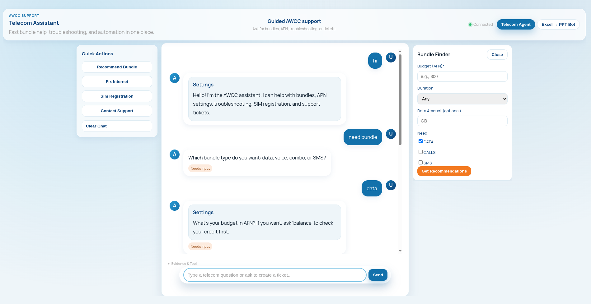
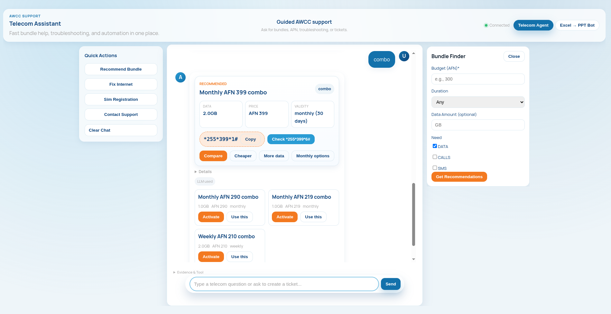

# telecom_agent-portfolio

AWCC-style telecom support AI agent portfolio: bundles, APN/settings, troubleshooting, RAG + citations, DB-grounded USSD codes, and CSV→PPT automation.

**Demo video:** https://drive.google.com/drive/folders/1otbcA6my9PFb-Dbyd86d9FMx0Kbcvyk6?usp=drive_link

**Live demo:** coming soon...

---

## What it does
- **Telecom Support Agent:** bundle recommendation + lookup, APN/settings guidance, internet troubleshooting, SIM/registration info, and support ticket flow.
- **Automation Agent:** **CSV/Excel → PowerPoint** report generation (data transformation + file output).

---

## Key features
- **DB-grounded USSD (no hallucinated codes):** activation/check/deactivate codes are returned only from the database/KB.
- **RAG with citations:** answers pull from local KB docs and include cited snippets.
- **Slot-filling flows:** e.g., bundle selection asks for budget/type/validity before recommending.
- **Flow switching (no stuck state):** user can switch from bundles → APN/troubleshooting anytime.
- **Controlled OpenAI usage:** OpenAI is used only for routing/typo-fixing/smalltalk (optional), with `api_used` + JSONL logs.

---

## Screenshots




---

## Tech stack
- **Backend:** FastAPI (Python), SQLite/PostgreSQL, RAG over markdown KB, structured logging
- **Frontend:** React (Vite), conversational UI, copy-to-clipboard for USSD
- **Automation:** CSV/Excel parsing + PPT generation
- **Optional:** OpenAI API router/classifier (logged)

---

## Architecture (high level)
1) UI sends `{ session_id, message }` to `/api/chat`  
2) Router detects intent + manages flow state  
3) For bundles → query DB (codes from DB only)  
4) For settings/troubleshooting → RAG over KB + citations  
5) For automation → file upload → PPT output

---

## Quick start (local)

### 1) Backend
```bash
cd backend
python -m venv .venv
source .venv/bin/activate
pip install -r requirements.txt
cp .env.example .env
uvicorn app.main:app --reload
